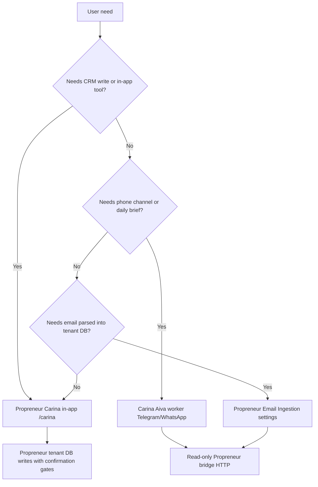

# SOP 014: Carina + Propreneur Operator Guide
**Classification:** Internal VERLOX only. Do not share externally.
**Source:** Migrated from planning/operations/CARINA_PROPRENEUR_COMPLEMENT_GUIDE.md
**Last reviewed:** 2026-06-25

---

# Carina + Propreneur complement guide (operators)

**Updated:** 2026-06-24
**Audience:** Platform ops, pilot onboarding (Glen / xelox), tenant admins
**Principle:** Unity is strength. Addition, not replacement. Two runtimes; one shared brain; one read bridge.

**Related:** `SOP/015-carina-propreneur-convergence.md`, `SOP/007-aiva-pilot-onboarding.md`, `brain/knowledge/132-aiva-propreneur-bridge-phase1.md`

---

## Which agent when?



| Need | Use | Owner | Flags |
|------|-----|-------|-------|
| Deal analysis, calculators, CRM writes, compliance updates | Propreneur Carina (`/carina`) | Propreneur | `carina_ai`, `carina_agent` |
| Daily portfolio brief on Telegram/WhatsApp | Aiva worker | Carina core | `AI_WORKERS_ENABLED`, `PROPREENEUR_BRIDGE_ENABLED`, `AIVA_DAILY_SUMMARY_ENABLED` |
| Portfolio Q&A on phone ("rent on Flat 4?") | Aiva + read bridge | Carina consumes Propreneur | `aiva_external_bridge` (PP), `PROPREENEUR_BRIDGE_ENABLED` (Carina) |
| Inbound IMAP from property manager / accountant | Propreneur settings | Propreneur only | existing email ingestion cron |
| Property law RAG / brain knowledge | Both after sync | Shared `brain/knowledge/` | `rag:ingest-brain-knowledge` (PP), property-uk pack (Carina) |
| External tool audit on Aiva | Scout (optional) | Scout | `LABYRINTH_ENABLED` |

**Use both:** Propreneur ingests email and holds domain truth; Aiva delivers summaries and mobile Q&A via the read bridge. They are not interchangeable.

---

## Glen / pilot onboarding (summary)

Full steps: `SOP/007-aiva-pilot-onboarding.md`.

1. **Propreneur tenant:** Enable `aiva_external_bridge`. Configure **Settings -> Email ingestion** (IMAP). Generate **Settings -> Carina Remote** API key.
2. **Carina core:** Set `PROPREENEUR_BRIDGE_ENABLED=true`, `AIVA_DAILY_SUMMARY_ENABLED=true`, keep `EMAIL_INGESTION_ENABLED=false` when Propreneur owns the mailbox.
3. **Aiva:** Create worker (property-uk / Property Manager template). Connect Telegram. Bind tenant slug + API key (`POST /api/aiva/workers/:id/propreneur/bind`). Enable summary config.
4. **Smoke:** Bridge portfolio GET, Telegram Q&A, email-activity GET, daily summary cron.

---

## Architecture (read path)

```
Propreneur IMAP (/settings/email-ingestion)
        |
        v
email_processing_logs
        |
        +-- GET /api/aiva-bridge/*  (Bearer Carina remote key)
                |
                v
Carina Aiva  -->  daily summary + portfolio Q&A (Telegram)
```

Propreneur in-app Carina stays on the left branch for writes; it does not call the bridge for normal chat.

---

## Bridge endpoints (read-only)

| Method | Path |
|--------|------|
| GET | `/api/aiva-bridge/portfolio` |
| GET | `/api/aiva-bridge/properties/{id}` |
| GET | `/api/aiva-bridge/properties/{id}/compliance` |
| GET | `/api/aiva-bridge/deals` |
| GET | `/api/aiva-bridge/email-activity?hours=24` |

Requires tenant flag `aiva_external_bridge` and `Authorization: Bearer {carina_remote_api_key}`.

---

## Troubleshooting

| Symptom | Likely cause | Fix |
|---------|--------------|-----|
| Bridge **401** | Missing or revoked API key | Regenerate key in **Settings -> Carina Remote**; re-bind Aiva |
| Bridge **404** | `aiva_external_bridge` off for tenant | Platform admin -> Feature flags -> enable for tenant |
| Bridge **503** on Carina | `PROPREENEUR_BRIDGE_ENABLED=false` | Set env on Carina core; restart |
| **Empty portfolio** | Wrong tenant slug or no properties | Verify slug matches subdomain; add test property |
| Bind fails before save | Portfolio smoke test failed | Check slug, key, and flag; curl portfolio endpoint |
| **Duplicate email** / double processing | Same mailbox in PP and Carina IMAP | Remove Carina IMAP connect; use bridge `email-activity` only |
| Carina IMAP **409** on connect | Worker already Propreneur-bound | Expected; do not connect IMAP on bound worker |
| Summary not delivered | No Telegram thread | User must message bot once; check `AIVA_DAILY_SUMMARY_ENABLED` |
| Aiva answers without real data | Bridge off or unbound | Bind worker; enable bridge flags |

---

## Do not

- Replace Propreneur in-app Carina with Aiva for CRM writes (Aiva only **proposes**; admin approves).
- Run Carina IMAP poller on a mailbox already in Propreneur email ingestion.
- Open direct SQL from Carina core into Propreneur tenant databases.
- Force-merge the two agent engines into one chat widget.
- Enable bridge flags globally in production before pilot smoke test on a dedicated tenant.
- Store Propreneur API keys in plaintext outside the vault ref on `ai_workers`.

---

## Phase 2 writes (review queue)

When `aiva_bridge_writes` (Propreneur) and `PROPREENEUR_BRIDGE_WRITES` (Carina) are on:

1. Aiva tools `propreneur-propose-deal`, `propreneur-propose-compliance-update`, `propreneur-propose-financial-log` POST to `/api/aiva-bridge/proposals/*`.
2. Response is always `pending_review`; **never** tell the user the CRM row exists until approved.
3. Workspace admin reviews at **Settings > Aiva bridge review** (requires `aiva_bridge_review_queue`).
4. Approve runs `PipelineService`, `ComplianceItem`, or `TenancyRentPayment` via existing domain services.
5. Reject leaves no side effects. Idempotent replay uses `Idempotency-Key` header.

Optional: `email_processed` webhooks may auto-create a **financial_log** proposal when extracted rent data matches a portfolio property (still requires approval).

## Carina-only IMAP (A14)

Use Carina IMAP **only** when Propreneur does not poll the mailbox:

1. Leave the Aiva **unbound** from Propreneur (or use a standalone Aiva with no tenant slug).
2. Set `EMAIL_INGESTION_ENABLED=true` on Carina core.
3. Connect via `POST /api/aiva/email/connect` and configure senders.
4. Background poll runs on `AIVA_EMAIL_POLL_CRON` (default every 5 minutes, Europe/London).
5. Digests land in `worker_email_digests` and feed daily summaries.

If you later bind the Aiva to Propreneur, Carina drops the stored IMAP connection and stops polling automatically.

---

## Validation

```bash
# Carina bridge unit tests
cd carina/02-backends/core.carinaai.uk
pnpm test src/ingestion/email/email-poller.test.ts src/workers/portfolio-context.test.ts src/workers/aiva-message-handler.test.ts

# Propreneur bridge isolation
cd propreneur/propreneur-v2
php artisan test --filter=AivaBridge

# Propreneur proposal queue
php artisan test --filter=AivaBridgeProposal

# Brain sync after editing 08-carina.md
bash carina/scripts/sync-brain-from-propreneur.sh
```

Manual: follow `SOP/007-aiva-pilot-onboarding.md` on xelox test tenant end-to-end.
