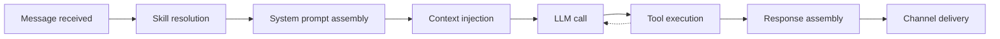

**Status: COMPLETED 2026-06-21**


# Gap 27 - Prompt 01: Agent Loop & Session Lifecycle Docs

**Gap:** 27 Documentation: Agent Architecture
**Prompt number:** 01 of 03
**Name:** Write agent-loop.md and sessions.md
**Primary agent:** Claude Code (docs writing)
**Estimated hours:** 2 h
**Depends on:** Nothing

---

## Post-build (MANDATORY)

When all "Done When" criteria in this prompt are satisfied:

1. Add `**Status: COMPLETED YYYY-MM-DD**` at the top of this file (use today's date).
2. Add a "**What was built:**" bullet list of key files or features shipped.
3. Move this file from `carina/internal/prompts/pending_prompts/` to `carina/internal/prompts/archived_prompts/pending_prompts/`, keeping the same relative path. Use `git mv` when possible.
4. If every prompt in this gap folder is COMPLETED, move the whole gap folder and update its `README.md` the same way.
5. Do not leave completed prompts in `pending_prompts/`; agents treat that folder as active work only.

Full checklist: `carina/internal/prompts/pending_prompts/POST-BUILD-CHECKLIST.md`


## Read first

1. `internal/servers/core.carinaai.uk/src/agents/agent-runner.ts` -- agent loop
2. `internal/servers/core.carinaai.uk/src/gateway/router.ts` -- session handling
3. `internal/servers/core.carinaai.uk/src/agents/session-manager.ts` -- session lifecycle
4. `marketing/docs/docs.carinaai.uk/docs/developer/architecture/overview.md` -- existing overview

---

## Goal: Write 2 architecture pages

### 1. `docs/developer/architecture/agent-loop.md`

```markdown
# Agent Loop & Turn Pipeline

## Overview
When a message arrives on any channel, the Gateway Router creates or
reuses a session and dispatches the message through the agent loop.
The agent loop is the core pipeline that turns a user message into
an AI response.

## Entry Points
- **Channel message**: Telegram, Discord, WhatsApp, WebChat, etc.
- **CLI command**: `carina chat "message"`
- **Scheduled task**: cron job, heartbeat, REM nightly
- **ACP session**: agent communication protocol for IDE sub-agents

## Pipeline Stages



### Stage 1: Skill Resolution
Carina loads skill packs relevant to the current session. Precedence:
workspace skills > project skills > personal skills > bundled skills.
Skills inject procedural knowledge into the system prompt.

### Stage 2: System Prompt Assembly
Carina builds a fresh system prompt per turn. Sections include:
- Identity and boundaries (SOUL.md)
- Tool definitions (filtered by allowlist and tier)
- Memory context (MEMORY.md, daily notes, REM promotions)
- Standing orders (persistent user directives)
- Security posture (sandbox mode, Scout threat level)
- Workspace context (AGENTS.md, TOOLS.md)

### Stage 3: Context Injection
Before the LLM call, Carina injects:
- Current session transcript (compacted if needed)
- Cross-session context (from identity-linked channels)
- Steer events (from command queue if active)

### Stage 4: LLM Call
Carina routes to the configured model provider with:
- Assembled messages
- Tool definitions
- Thinking level (off/minimal/low/medium/high/xhigh/max/adaptive)
- Provider-specific parameters

### Stage 5: Tool Execution
If the LLM requests tool calls, Carina executes them in sequence:
1. Check tool is in session allowlist
2. Check sandbox policy (Docker, SSH, OpenShell, or host)
3. Check exec approval level (off, on-miss, full)
4. Check Scout threat level (if Scout is active)
5. Execute tool, sanitise result, record trajectory

### Stage 6: Response Assembly
Carina assembles the final response from:
- LLM text output
- Tool call results
- System messages (memory promotions, standing order effects)

### Stage 7: Channel Delivery
The response is delivered to the originating channel. If the session
is docked to a different channel, delivery routes there instead.

## Where to find it in source
- `agents/agent-runner.ts` -- main loop orchestrator
- `agents/system-prompt.ts` -- prompt assembly
- `agents/tool-runner.ts` -- tool execution pipeline
- `gateway/router.ts` -- GatewayRouter dispatcher
```

### 2. `docs/developer/architecture/sessions.md`

```markdown
# Session Lifecycle

## Session Model
A session is a conversation between a user and Carina. Every message
belongs to exactly one session. Sessions are:

- **Isolated**: messages from different users never mix
- **Persistent**: sessions survive Gateway restarts
- **Resettable**: users can start fresh with /new or /reset
- **Linked**: identity-linked sessions share context across channels

## Session Creation
When a message arrives:
1. IdentityResolver resolves the sender to a canonical user ID
2. GatewayRouter looks up or creates a session keyed by `session:<canonicalId>`
3. If cross-channel sharing is enabled, existing sessions are reused
4. New sessions get a fresh turn pipeline, skill pack load, and system prompt

## Session Storage
Sessions are stored as JSONL transcripts at:
~/.carina/sessions/<agentId>/<sessionId>.jsonl

Each line is one turn: user message, assistant response, tool calls, errors.
Memory backends (Postgres, SQLite, Mem0, Honcho) index sessions for search.

## Session Lifecycle Events

| Event | Trigger | Effect |
|-------|---------|--------|
| Created | First message | New JSONL file, bootstrap injection |
| Active | Each turn | Transcript appended, lastInteractionAt updated |
| Idle | No messages for idleMinutes | Session may be auto-reset |
| Reset | /new or /reset | JSONL archived, new session created |
| Compacted | Context exceeds limit | Old turns summarised, memory flush triggered |
| Expired | Daily reset (4AM) | Session archived if idle |
| Drained | Session close | Memory flush, trajectory bundle archived |

## Session Identity Links
When a user links identities across channels (e.g., Telegram + WebChat),
both channels share the same session. The session metadata tracks which
channel is currently the reply destination (see Channel Docking).

## Where to find it in source
- `agents/session-manager.ts` -- session lifecycle
- `gateway/router.ts` -- GatewayRouter session creation
- `gateway/identity-resolver.ts` -- identity resolution
- `memory/backends/` -- session storage backends
```

---

## Sidebar update

Add both pages under the "Architecture" category in `sidebars.ts`.

---

## Existing Carina files to reference

- `internal/servers/core.carinaai.uk/src/agents/` -- all agent code
- `internal/servers/core.carinaai.uk/src/gateway/router.ts` -- GatewayRouter
- `internal/servers/core.carinaai.uk/src/platform/platform-knowledge.md` -- runtime knowledge
