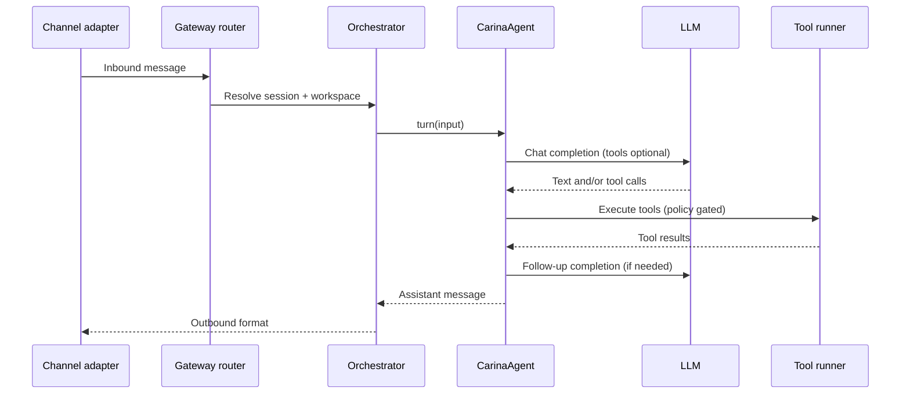

# Agent loop

The agent loop is the core turn cycle: receive message, assemble context, call the LLM, execute tools, stream or finalize the reply.

## Steps in one turn

1. **Session resolution** - Map channel identity to a stable session key (`gateway/router.ts`).
2. **Context build** - System prompt, memory hits, skills, channel metadata (`agents/system-prompt.ts`, memory modules).
3. **LLM call** - Provider selected from config or workspace profile (`brain/llm.ts`).
4. **Tool execution** - Registry dispatches tools; Scout and sequence guards may block or confirm (`tools/`, `security/`).
5. **Response delivery** - Formatting per channel (markdown subset, streaming edits, etc.).

## Where to find it in source

| Piece | Path under `core.carinaai.uk/src/` |
|---|---|
| Orchestrator entry | `agents/orchestrator.ts` |
| Single turn | `agents/carina.ts` (`CarinaAgent.turn`) |
| Tool dispatch | `agents/tool-runner.ts` (or equivalent in orchestrator wiring) |
| Gateway routing | `gateway/router.ts` |

## Related

- [Sessions](/docs/developer/architecture/sessions)
- [System prompt](/docs/developer/architecture/system-prompt)
- [Multi-agent routing](/docs/developer/architecture/multi-agent-routing)
