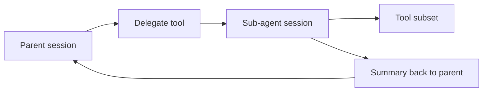

# Delegation and sub-agents

Carina can delegate work to sub-agents for isolated tool use, parallel research, or specialist personas.

## When to delegate

- Long-running research with many tool calls
- Risk isolation (sub-agent has narrower tool allowlist)
- Cron and scheduled tasks spawning one-shot agents

## Sub-agent lifecycle

1. Parent issues delegate instruction with goal and constraints
2. Sub-agent runs in its own session id with capped turns
3. Result is summarized back to the parent session (not full raw logs by default)

## Configuration

- Tool allowlists via workspace toolsets and Scout policy
- Timeouts and max turns in orchestrator config

## Source references

- `agents/subagent-*.ts`
- `agents/orchestrator.ts`
- Cron / taskflow spawn paths under `agents/` and `taskflow/`

## Related

- [Multi-agent routing](/docs/developer/architecture/multi-agent-routing)
- [Automation hooks](/docs/developer/automation/hooks)
