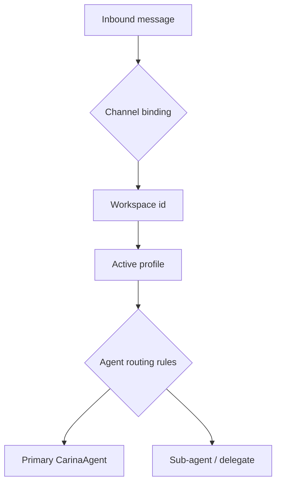

# Multi-agent routing

Carina routes inbound traffic to the correct workspace, profile, and agent instance based on channel bindings and workspace rules.

## Routing inputs

| Input | Source |
|---|---|
| Channel id | Telegram chat id, Discord guild, web session cookie, etc. |
| Workspace | `workspaces/` config and hosted tenant mapping |
| Profile | `profiles/manager.ts` active profile per workspace |
| Tool policy | Scout + workspace toolsets |

## Hosted vs self-hosted

- **Self-hosted:** bindings live in `~/.carina/` and gateway config.
- **Carina Cloud:** workspace id comes from auth; core proxy may forward tool calls to a dedicated core instance.

## Configuration

Set default workspace and channel maps in `.env` and workspace JSON under `~/.carina/workspaces/`.

CLI: `carina channels list`, `carina workspace` commands (see [CLI overview](/docs/developer/cli/overview)).

## Source references

- `workspaces/agent-routing.ts`
- `gateway/router.ts`
- `gateway/channel-docking.ts` (linked identities across channels)

## Related

- [Agent loop](/docs/developer/architecture/agent-loop)
- [Delegation](/docs/developer/architecture/delegation)
