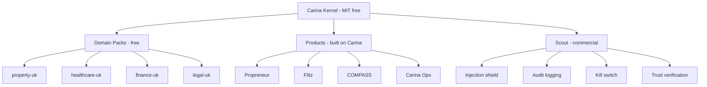

# Platform architecture

Carina is organized as a free MIT kernel with optional commercial layers and products built on top. See [Brand rules](https://github.com/malike2356/carina-mutant/blob/main/docs/kernel/BRAND_RULES.md) for naming and licensing.

## Carina kernel (free, MIT)

The agent engine: tools registry, memory and RAG, model routing with 23 live providers in the public package, 19 channel adapters, skill pack system, and MCP support. Install with `npm install -g carina-agent`. Always free. Always open source.

## Domain packs (free, MIT)

Optional vertical knowledge and workflows: property-uk, healthcare-uk, finance-uk, legal-uk, and others. Install only what your product needs via `ACTIVE_SKILL_PACKS` or the Hub. Packs are distros for the kernel, not part of the core install.

## Products (built on Carina)

Vertical applications and hosted offerings that run on the same kernel:

- **Propreneur** - UK property investment platform (Powered by Carina)
- **Flitz** - Fleet tracking for Africa (Built on Carina; in development)
- **COMPASS** - NHS compliance copilot (Powered by Carina; pilot)
- **Carina Ops** - Hosted multi-tenant SaaS (commercial)

Products say "powered by Carina" or "built on Carina." They may optionally add Scout for production security.

## Scout (commercial)

The security layer: prompt injection shield, audit logging, kill switch, trust verification, and compliance exports. Optional. Carina runs without Scout when `LABYRINTH_ENABLED=false`.

Scout is never bundled with the MIT core. See [Commercial boundaries](/docs/user/pricing) and [Labyrinth Scout](/docs/user/security/labyrinth-scout).

## Further reading

- [Manifesto](/docs/developer/manifesto)
- [MANIFESTO.md on GitHub](https://github.com/malike2356/carina-mutant/blob/main/MANIFESTO.md)
- [Commercial boundaries](/docs/user/pricing)
- [Creating skill packs](/docs/developer/skills/packs)
