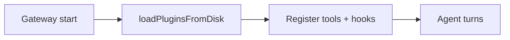

# Plugin system overview

Carina extends LLM providers, tools, and lifecycle hooks through a plugin loader. Plugins ship as local modules or npm packages discovered at startup.

## Plugin types

| Type | Purpose |
|---|---|
| Provider plugins | Register custom OpenAI-compatible or native LLM backends |
| Tool / skill plugins | Add tools via skill pack manifests |
| Hook plugins | Run code on events (message in, tool out, cron tick) |

## Discovery

At startup the loader scans:

- Built-in registrations in `src/plugins/`
- User directory under `~/.carina/plugins/`
- Provider plugin paths from env (`CARINA_PROVIDER_PLUGINS`)

CLI: `carina providers list`, `carina hooks list`.

## Lifecycle

## Source references

| Module | Role |
|---|---|
| `plugins/registry.ts` | Disk discovery and registration |
| `plugins/loader.ts` | Provider factory loading |
| `plugins/types.ts` | Plugin manifest types |

## Related

- [Building plugins](/docs/developer/plugins/building-plugins)
- [Tool registry](/docs/developer/tools/registry)
