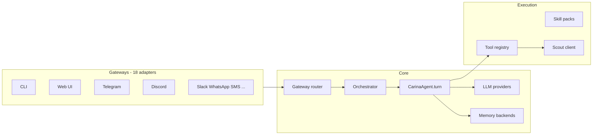

# Architecture overview

Carina follows a gateway + agent + tools architecture similar in spirit to Hermes/OpenClaw, with multi-tenant SaaS and Scout security as differentiators.

## Main modules (`core.carinaai.uk/src/`)

| Module | Role |
|---|---|
| `agents/` | `CarinaAgent`, orchestrator, sub-agents, cron |
| `brain/` | LLM providers, credential pools, prompt cache |
| `gateway/` | Channel adapters, web UI, router |
| `tools/` | Tool registry and implementations |
| `memory/` | Episodic store, RAG, pluggable backends |
| `skills/` | Packs, curator, auto-writer |
| `security/` | Prompt guard, Scout reporting, JIT credentials |
| `cli/` | 49 CLI commands |
| `commitments/` | Inferred follow-up memories (opt-in) |
| `workspaces/` | Named agent workspaces and channel routing |
| `ops/` | Sandbox, DNS, proxy, backup, secrets reload, audit |
| `infrastructure/` | Host service, device pairing, control auth |

## Request flow

1. Inbound message arrives on a channel adapter
2. `GatewayRouter` maps to a session and `CarinaOrchestrator`
3. Context is built: memory search, RAG, skills, system prompt
4. LLM may return tool calls; `tool-runner` executes with Scout policy
5. Response is formatted per platform and sent outbound

## Deployment modes

- **CLI / self-hosted**: `~/.carina/` config, local Postgres + Redis
- **Carina Cloud**: multi-tenant Postgres schemas, Stripe billing, hosted web app
- **Docker**: `docker-compose.yml` for Postgres, Redis, and the agent container
