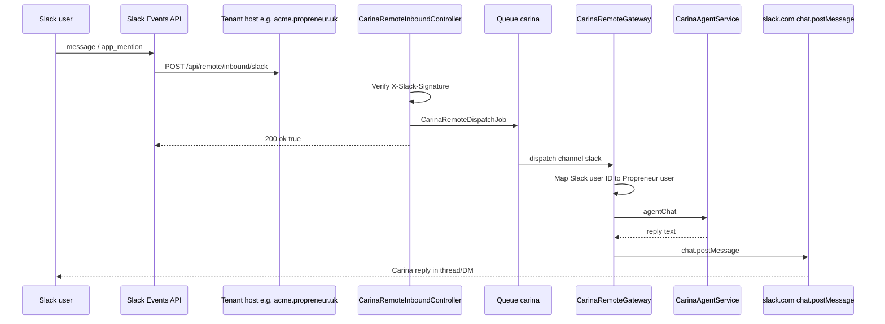
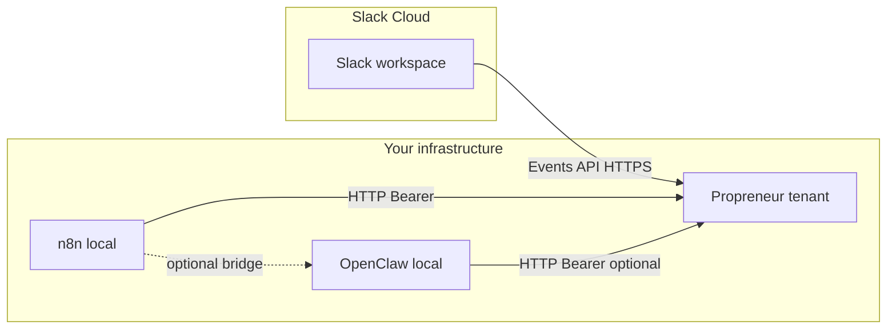

# Carina ↔ Slack — integration guide and build plan

**Status:** Foundation implemented (adapter + inbound route + settings UI partial). Production-ready **private Slack app** requires config wiring, per-tenant channel keys, and ops runbook. **Slack Marketplace** listing is a separate multi-phase product.

**Related:** `brain/knowledge/144-carina-remote-api.md` (all remote channels), `docs/SECURITY_ATTACK_VISUALIZATION.md` (platform security alerts — different from Carina chat).

**Last updated:** 2026-05-20

---

## 1. Goals (two different products)

| Goal | What users see | Effort | This repo today |
|------|----------------|--------|-----------------|
| **A. Carina in Slack** | DM or @mention Carina in a workspace; replies use tenant Carina agent + tools | Days–weeks (private app) | **~70%** — adapter exists; gaps below |
| **B. Slack Marketplace / AI agents directory** | “Carina” installable by any Slack customer from [Slack app directory](https://slack.com/marketplace) | Months | **Not started** — needs OAuth + review |

Do not confuse with:

- **`BACKUP_SLACK_WEBHOOK_URL`** / **`SECURITY_ALERT_EMAIL`** — one-way notifications only, not conversational Carina.
- **n8n / OpenClaw** — external automation; can call HTTP remote API or sit beside Slack, not replacements for Events API.

---

## 2. Current architecture (implemented)



### 2.1 Code map

| Layer | Path / symbol |
|-------|----------------|
| Inbound route | `POST /api/remote/inbound/slack` → `carina.remote.inbound.slack` (`routes/tenant.php`) |
| Controller | `App\Http\Controllers\Api\CarinaRemoteInboundController::slack()` |
| Adapter | `App\Services\Carina\Remote\Channels\SlackChannelAdapter` |
| Registry | `CarinaRemoteChannelRegistry` (slug `slack`) |
| Async job | `App\Jobs\CarinaRemoteDispatchJob` → queue **`carina`** |
| Agent | `CarinaRemoteGateway` → `CarinaAgentService::agentChat()` |
| Tenant UI | `GET /settings/carina-remote` → `CarinaRemoteSettingsController` |
| Setup blurb | `resources/views/tenant/settings/carina-remote/partials/setup-guide.blade.php` |
| Tests | `tests/Feature/Carina/Remote/*`, `tests/Unit/Carina/Remote/*` (Slack-specific coverage thin) |

### 2.2 Tenant database tables

| Table | Purpose |
|-------|---------|
| `carina_remote_api_keys` | Bearer keys for HTTP; also referenced by inbound channels |
| `carina_remote_channel_mappings` | `(channel, external_id)` → `users.id` — **required** for Slack user IDs |
| `carina_remote_sessions` | Conversation continuity (~4h TTL) |
| `tenant_settings` | `carina_remote_channel_key_{channel}` → which API key handles inbound |

### 2.3 Slack adapter behaviour

- **Verification:** Slack signing secret (`v0:timestamp:body` HMAC), 5-minute skew window.
- **URL verification:** `type=url_verification` → JSON `{ "challenge": "..." }` (handled in controller before async path).
- **Ignores:** Bot messages (`event.bot_id` set).
- **Parses:** `event.user` → `externalId`, `event.text` → message, `event.channel` → `replyTarget`.
- **Replies:** `POST https://slack.com/api/chat.postMessage` with bot token.

### 2.4 Configuration (today)

Adapter reads:

```php
config('services.slack_remote.bot_token')
config('services.slack_remote.signing_secret')
```

**Gap:** `config/services.php` must define `slack_remote` (see Phase 0). Env names used in setup guide:

```env
SLACK_BOT_TOKEN=xoxb-...
SLACK_SIGNING_SECRET=...
```

**Important limitation:** Tokens are **server-level `.env`**, not per-tenant DB. One Slack app install currently implies **one bot token for the whole deployment** unless Phase 2+ is built.

### 2.5 Inbound prerequisites (per workspace)

1. **HTTPS tenant host** reachable by Slack: `https://{tenant-domain}/api/remote/inbound/slack`.
2. **`slack_remote` configured** on server (bot token + signing secret).
3. **Active Carina remote API key** assigned to Slack channel:
   - Tenant setting key: `carina_remote_channel_key_slack` = `{api_key_id}`.
   - **UI gap:** WhatsApp has “Save channel key” form; Slack does not yet — use tinker/SQL or Phase 0 UI.
4. **Channel mapping** for each Slack user: Settings → Carina Remote → Channel Mappings → channel `slack`, external_id = Slack member ID (e.g. `U01234ABCD`).
5. **Horizon** processing queue `carina` (supervisor `propreneur-horizon` on production).

### 2.6 HTTP alternative (no Slack app)

Integrations (n8n, scripts, OpenClaw bridge) can call:

```http
POST https://{tenant}/api/remote/carina/chat
Authorization: Bearer crm_...
Content-Type: application/json

{ "message": "Summarise my pipeline", "session_id": "optional-stable-id" }
```

Pinned user on the API key supplies identity when `external_id` is empty.

---

## 3. Private Slack app — operator runbook (Phase 1)

Use this to get **Carina talking in one workspace** before Marketplace work.

### 3.1 Create Slack app

1. [api.slack.com/apps](https://api.slack.com/apps) → **Create New App** → From scratch.
2. Name e.g. `Carina (Propreneur)`; pick dev workspace.
3. **OAuth & Permissions → Bot Token Scopes** (minimum starting set):

   | Scope | Why |
   |-------|-----|
   | `chat:write` | Post replies |
   | `im:history` | DM messages |
   | `im:read` | DM metadata |
   | `app_mentions:read` | @Carina in channels |
   | `channels:history` | Channel messages (if used in channels) |
   | `users:read` | Resolve users (optional but useful) |

4. **Install to Workspace** → copy **Bot User OAuth Token** (`xoxb-…`).
5. **Basic Information** → **Signing Secret**.

### 3.2 Event subscriptions

1. Enable Events.
2. **Request URL:** `https://{your-tenant-domain}/api/remote/inbound/slack`  
   Example: `https://acme.propreneur.uk/api/remote/inbound/slack`
3. Slack sends `url_verification`; MIS must return challenge (already implemented).
4. Subscribe to bot events, e.g.:
   - `message.im` — DMs to the bot
   - `app_mention` — @mentions in channels
   - Add `message.channels` only if you need ambient channel messages (noisier).

### 3.3 Server `.env` (aman / production)

```env
SLACK_BOT_TOKEN=xoxb-...
SLACK_SIGNING_SECRET=...
```

Then:

```bash
php artisan config:clear
sudo supervisorctl restart propreneur-horizon
```

### 3.4 Tenant setup (workspace admin)

1. **Settings → Carina Remote → API Keys** → Generate key (optionally link a default user).
2. Assign key to Slack channel (until UI exists):

   ```bash
   # tenant context — replace IDs
   php artisan tinker
   # TenantSetting::updateOrCreate(
   #   ['key' => 'carina_remote_channel_key_slack'],
   #   ['value' => '1', 'group' => 'carina_remote']
   # );
   ```

3. **Channel Mappings** → channel `slack`, external_id = Slack user ID, workspace user = Propreneur account.
4. Invite bot to channel or open DM with app.

### 3.5 Find Slack user ID

- Slack profile → ⋮ → **Copy member ID** (with admin/developer prefs), or
- Inspect event JSON in Slack app **Event Subscriptions** delivery logs, or
- `users.list` API during setup.

### 3.6 Verify

| Check | Expected |
|-------|----------|
| Channel Status tab | Slack = **Configured** |
| DM bot “hello” | Job on `carina` queue; reply in Slack |
| Unmapped Slack user | No reply or unauthorized path in logs |
| `storage/logs` / security log | No `carina_remote_inbound_verify_failed` |
| Destructive Carina action | Remote message: approval required in web UI |

### 3.7 Troubleshooting

| Symptom | Likely cause |
|---------|----------------|
| URL verification fails | Wrong host, TLS, or nginx routing not hitting tenant app |
| 401 on events | Wrong signing secret or clock skew > 5 min |
| 503 Channel not configured | Missing `slack_remote` config or empty tokens |
| 503 after verify | No `carina_remote_channel_key_slack` tenant setting |
| No reply, 200 OK | Missing user mapping, empty message, or bot message ignored |
| Reply delayed | Queue backlog — check Horizon `carina` |
| Wrong tenant receives event | **Architectural:** single global token — see Phase 2 |

---

## 4. Slack Marketplace path (Phase 4–5)

To appear alongside apps like Cursor or Claude in Slack’s AI/agent surfaces:

### 4.1 Requirements (Slack-side)

- Public **privacy policy** and **support** URL.
- **OAuth 2.0** “Add to Slack” (not manual token paste).
- Justified **scope list** minimal for Carina features.
- **App review** submission (security questionnaire).
- **Distribution**: public vs internal; Marketplace listing assets (icon, screenshots, description).
- Optional: [Slack platform AI/agent features](https://api.slack.com/) — additional compliance and UX guidelines.

### 4.2 Platform-side (Propreneur)

| Component | Description |
|-----------|-------------|
| Central OAuth controller | `GET /integrations/slack/install`, callback stores tokens |
| `slack_installations` table (central or tenant) | `team_id`, `enterprise_id`, `bot_token`, `installed_by`, `tenant_id` |
| Event router | Single URL e.g. `https://api.propreneur.uk/slack/events` → resolve tenant by `team_id` |
| Tenant onboarding UI | “Connect Slack” in Carina Remote settings |
| Token encryption | Laravel encrypted casts / vault |
| Uninstall handler | `app_uninstalled` event → revoke tokens |
| Multi-workspace SaaS | Each customer’s Slack team maps to exactly one Propreneur tenant |

### 4.3 Marketing / product

- Listing copy: property / deal / mentoring positioning vs generic chat.
- Demo workspace + screenshot set.
- Support runbook for Slack-specific incidents.

---

## 5. n8n and OpenClaw (local hosting)

Both can coexist with Carina Remote; they solve different layers.



| Tool | Connect to Slack | Connect to Carina |
|------|------------------|-------------------|
| **n8n** | Slack node (OAuth); triggers need **public URL** or Socket Mode | HTTP Request → `/api/remote/carina/chat` |
| **OpenClaw** | Same as any local agent — outbound `chat.postMessage` or Slack Socket Mode | Direct HTTP to tenant with remote API key |
| **Carina native** | `SlackChannelAdapter` webhook | Built-in |

**Local-only Slack triggers:** use [Socket Mode](https://api.slack.com/apis/connections/socket) so Slack does not call your LAN IP. n8n documents Slack trigger constraints; OpenClaw depends on its Slack plugin.

**Recommendation:** Use **native Carina Slack** for product UX; use **n8n** for ops glue (security alerts, backups, CRM side effects); use **OpenClaw** for experimental agent tasks — not as the primary Carina Slack transport unless you want a forked integration.

---

## 6. Security and compliance

| Topic | Guidance |
|-------|----------|
| Webhook authenticity | Always verify signing secret; already enforced |
| Token storage | Move from `.env` to encrypted per-tenant (Phase 2) |
| Least privilege | Start with DM + `app_mention` only |
| Data residency | Carina messages processed on MIS; inform Slack app privacy policy |
| Audit | `CarinaSecurityAuditLogger` logs `carina_remote_dispatch` |
| Destructive tools | Remote boundary returns approval message — no auto-approve in Slack |
| Rate limits | `carina_remote_api` rate limiter on HTTP; consider Slack event flood controls |
| Security dashboard | Inbound verify failures should log to `security` channel / `security_events` (future) |

---

## 7. Build plan (phased)

### Phase 0 — Config and ops glue (1–2 days) **← do first**

| # | Task | Owner | Done when |
|---|------|-------|-----------|
| 0.1 | Add `services.slack_remote` in `config/services.php` + `.env.example` | Dev | `SlackChannelAdapter::isConfigured()` true with env set |
| 0.2 | GUI: assign **Slack channel API key** (parity with WhatsApp tab) | Dev | Tenant admin can select key without tinker |
| 0.3 | Expand setup guide: tenant URL template, scopes list, mapping screenshot | Dev | `setup-guide.blade.php` accurate |
| 0.4 | Feature test: signed Slack `url_verification` + `event_callback` fixture | Dev | CI green |
| 0.5 | Production runbook section in `docs/DEPLOYMENT.md` link | Dev | Linked from deploy doc |
| 0.6 | Log `carina_remote_inbound_verify_failed` to `security_events` (optional) | Dev | Failed spoof visible on Security overview |

### Phase 1 — Private app MVP (3–5 days)

| # | Task | Done when |
|---|------|-----------|
| 1.1 | Run §3 runbook on one production tenant | DM Carina works E2E |
| 1.2 | Document “Get Slack member ID” in UI helper text | Admins self-serve mapping |
| 1.3 | Thread replies (`thread_ts`) for channel mentions | Replies stay in thread |
| 1.4 | `sendAck` typing indicator or “Thinking…” ephemeral (optional) | UX acceptable under load |
| 1.5 | Handle `app_home_opened` / slash command `/carina` (optional) | Discoverability |

### Phase 2 — Per-tenant credentials (1–2 weeks)

| # | Task | Done when |
|---|------|-----------|
| 2.1 | Migration `tenant_slack_integrations` (encrypted `bot_token`, `signing_secret`, `team_id`) | Tokens not in global `.env` |
| 2.2 | Settings UI: Connect / Disconnect Slack | Status tab shows team name + connected |
| 2.3 | Adapter reads tenant credentials when tenant context initialized | Multi-tenant safe |
| 2.4 | Admin doc: one Slack app per customer vs shared app | CS playbook clear |

### Phase 3 — Central OAuth “Add to Slack” (2–3 weeks)

| # | Task | Done when |
|---|------|-----------|
| 3.1 | Slack app redirect URLs on `propreneur.uk` | OAuth completes |
| 3.2 | Map `team_id` → tenant (signup slug or tenant picker) | Correct tenant routing |
| 3.3 | Auto-create channel mapping for installing user | First message works without manual ID copy |
| 3.4 | Handle token rotation / revocation | Uninstall clean |

### Phase 4 — Slack Marketplace listing (4–8+ weeks)

| # | Task | Done when |
|---|------|-----------|
| 4.1 | Privacy policy + DPA + support page | Review unblocked |
| 4.2 | Marketplace assets + demo video | Listing submitted |
| 4.3 | Slack app review feedback loop | App approved |
| 4.4 | Production distribution + install analytics | Live in directory |

### Phase 5 — Enhanced Slack UX (ongoing)

- Block Kit messages (cards for deals/properties).
- Slash commands menu.
- Slack AI/agent manifest if targeting “Put AI to work in Slack” category explicitly.
- Enterprise Grid / org-wide install.

---

## 8. Acceptance criteria (Phase 1 complete)

- [ ] Slack app installed in a test workspace.
- [ ] Request URL verified against production tenant domain.
- [ ] Mapped user receives Carina reply in DM within 60s under normal queue load.
- [ ] Unmapped user does not leak data; attempt logged.
- [ ] Carina tool requiring confirmation does not execute from Slack without web approval.
- [ ] Documentation: this file + updated `144-carina-remote-api.md` cross-links.
- [ ] Horizon `carina` queue monitored on aman.

---

## 9. Decision log (record changes here)

| Date | Decision | Rationale |
|------|----------|-----------|
| 2026-05-20 | Doc created; Phase 0–5 defined | Separate “chat in Slack” from Marketplace |
| | Default: private app per deployment first | Matches current adapter + global env |
| | Per-tenant OAuth before Marketplace | Required for public listing anyway |

---

## 10. Quick reference

| Item | Value |
|------|--------|
| Inbound URL | `https://{tenant}/api/remote/inbound/slack` |
| HTTP chat | `POST https://{tenant}/api/remote/carina/chat` |
| Settings | `/settings/carina-remote` |
| Queue | `carina` |
| Slack user mapping channel slug | `slack` |
| Tenant setting for API key | `carina_remote_channel_key_slack` |
| Adapter class | `SlackChannelAdapter` |

---

## 11. Related files to touch in future PRs

```
config/services.php                          # add slack_remote
.env.example                                 # SLACK_BOT_TOKEN, SLACK_SIGNING_SECRET
app/Services/Carina/Remote/Channels/SlackChannelAdapter.php
app/Http/Controllers/Api/CarinaRemoteInboundController.php
app/Http/Controllers/Tenant/Settings/CarinaRemoteSettingsController.php
resources/views/tenant/settings/carina-remote/*
routes/tenant.php
database/migrations/tenant/*_slack*.php    # Phase 2+
tests/Feature/Carina/Remote/SlackInboundTest.php
docs/DEPLOYMENT.md                           # link
brain/knowledge/144-carina-remote-api.md    # cross-link
```
